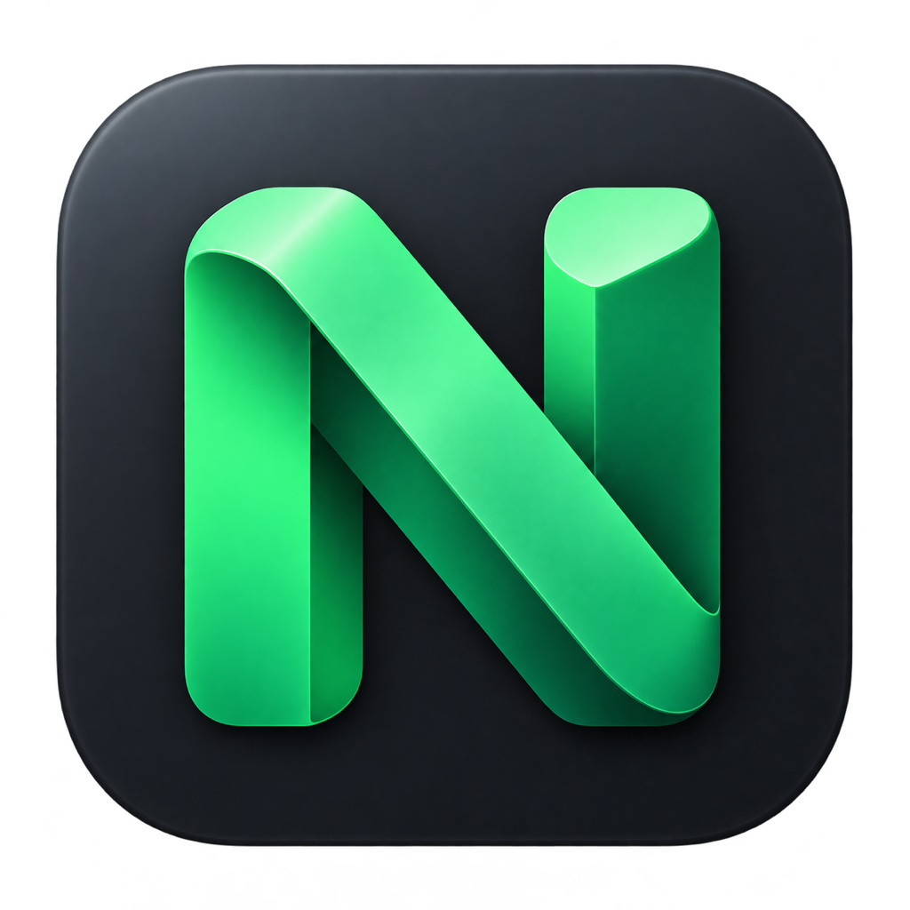

<p align="center">
  
</p>

# gui-nvm

在 macOS 上查看项目的 Node.js 版本要求、安装 Node、切换默认版本，并在保存前预览配置改动。

gui-nvm 的主要入口是 SwiftUI 原生应用，面向 Apple Silicon 和 macOS 14 及以上系统。项目扫描、版本解析、配置保存和安装任务都由本机 Swift 代码处理。应用自带所需的 nvm 脚本和 semver 资源，安装后无需启动 Web 服务，也无需保留源码仓库、Node、pnpm 或 Python。

仓库同时保留本机 Web 界面和 zsh 自动切换功能。终端自动切换需要单独启用；原生应用不会改写 shell 启动文件。

源码：[shawncai/gui-nvm](https://github.com/shawncai/gui-nvm)，开发分支为 `auto-switch`。原生应用当前版本为 `0.1.0`；shell 部分基于上游 nvm `0.40.3`。本文介绍从源码构建和本地安装，不依赖预先发布的 GitHub Release。

## 目录

- [构建、打包与安装](#构建打包与安装)
- [第一次打开](#第一次打开)
- [项目扫描与版本声明](#项目扫描与版本声明)
- [版本库与安装任务](#版本库与安装任务)
- [全局包管理](#全局包管理)
- [在 zsh 中启用自动切换](#在-zsh-中启用自动切换)
- [Web 备用入口](#web-备用入口)
- [本地数据与旧版迁移](#本地数据与旧版迁移)
- [快捷键](#快捷键)
- [常见问题](#常见问题)
- [开发与测试](#开发与测试)
- [权限与隐私](#权限与隐私)
- [贡献与许可证](#贡献与许可证)

## 能做什么

| 页面 | 功能 |
| --- | --- |
| 项目 | 添加项目与扫描目录，递归发现项目，按名称、路径、声明、目录和状态筛选，查看配置来源、解析结果及支持状态 |
| 项目详情 | 选择已安装版本或输入版本要求，预览并保存 `.nvmrc`、`.node-version`、`package.json` 中的 `engines.node` |
| 版本库 | 查看本机已安装版本、官方可安装版本、发布日期和支持阶段；安装版本，显式设置默认版本 |
| 全局包（原生版） | 查看各 Node 版本的全局包，筛选、删除或调整到指定版本 |
| 任务 | 查看 Node 安装和全局包操作的日志、结果，取消正在运行的任务；保留本次运行最近 30 条任务 |
| 设置 | 选择 nvm 目录，管理扫描目录，查看默认版本、扫描统计及错误 |

支持 monorepo 子项目和父目录继承声明。原生版与 Web 版共用真实项目文件和 nvm 安装目录，各自保存界面状态。

当前版本未提供 Intel 构建、Mac App Store 分发、自动更新、Node 卸载、项目删除或图形化 shell 集成安装器。

## 系统与构建要求

| 用途 | 要求 |
| --- | --- |
| 运行原生应用 | Apple Silicon Mac，macOS 14 或更新版本 |
| 构建原生应用 | 完整 Xcode、其命令行工具，以及 Python 3；无需第三方 Swift 包 |
| 使用终端自动切换 | 交互式 zsh、可用的 nvm 安装；解析 `engines.node` 需要至少一个已安装的 Node 10+ |
| 使用或开发 Web 版 | Node `22.22.3`、pnpm `8.15.8` |

原生工程当前在 Xcode `26.0.1` / Swift `6.2` 上构建验证，运行验证使用 macOS `15.7.5`。最低部署目标为 macOS 14，尚未完成 macOS 14 真机运行验证。

## 构建、打包与安装

### 1. 获取源码

选择一个长期保留的目录。如果之后还要安装终端自动切换，安装器会创建指向此源码目录的符号链接，安装后不要移动它。

```sh
mkdir -p "$HOME/Developer"
git clone --branch auto-switch https://github.com/shawncai/gui-nvm.git "$HOME/Developer/gui-nvm"
cd "$HOME/Developer/gui-nvm"
dot_clean ./
```

### 2. 生成应用与 DMG

先确认 `xcodebuild` 指向完整 Xcode，且 Python 3 可用：

```sh
xcodebuild -version
python3 --version
bash macos/scripts/package.sh
```

`package.sh` 会先构建 Release 应用，再做本地签名、生成 DMG 并验证。产物如下：

| 文件 | 用途 |
| --- | --- |
| `output/macos/gui-nvm.app` | 可直接运行的原生应用 |
| `output/macos/gui-nvm-0.1.0-arm64.dmg` | 将应用拖入 Applications 的安装镜像 |
| `output/macos/SHA256SUMS.txt` | DMG 的 SHA-256 校验值 |

打开 DMG，将 gui-nvm 拖入 Applications；也可将 `gui-nvm.app` 复制到 `~/Applications/`。应用运行不依赖源码目录。

只构建应用，或复用已构建的 Release 产物：

```sh
bash macos/scripts/build.sh
bash macos/scripts/package.sh --skip-build
```

构建缓存默认位于 `~/Library/Caches/gui-nvm/DerivedData/`。可用 `GUI_NVM_DERIVED_DATA` 指定其他本机 APFS 目录。构建脚本会从 `macos/Brand/AppIcon.png` 生成应用所需图标尺寸，并更新 Xcode 工程的源文件列表；图标处理使用系统 Swift/AppKit，无需额外依赖。

### 3. 验证签名与镜像

```sh
codesign --verify --deep --strict --verbose=2 output/macos/gui-nvm.app
cd output/macos
shasum -a 256 -c SHA256SUMS.txt
cd ../..
```

当前产物采用 **ad-hoc 本地签名**，未使用 Developer ID，也未经过 Apple 公证。它适合自行构建和本地使用。通过浏览器、聊天工具或其他网络渠道传到另一台 Mac 后，Gatekeeper 可能阻止首次打开。

确认源码和文件来源可信后，按 macOS 提示在「系统设置 → 隐私与安全性」中允许打开。不要关闭 Gatekeeper。面向广泛分发需要补充 Developer ID 签名和公证流程。

## 第一次打开

1. 打开 gui-nvm，在「设置」中确认 nvm 目录。
2. 若没有历史扫描目录，点击「添加扫描目录」，选择存放项目的目录；也可直接添加单个项目。
3. 扫描完成后选择项目，查看当前声明、来源文件和匹配到的已安装版本。
4. 如需修改，选择目标文件和版本要求，检查预览，再点击保存。

nvm 目录按以下顺序确定：

1. 原生应用设置中已保存的目录。
2. 启动应用时继承的 `NVM_DIR` 环境变量。
3. 默认目录 `~/.nvm`。

Finder 启动的应用通常不会继承终端中的自定义环境变量。使用自定义 nvm 目录时，请直接在应用设置中选择。切换目录只改变应用的管理目标，不会搬迁已有 Node 安装；Node 安装或全局包操作运行期间不能切换目录。

应用识别 `NVM_DIR/versions/node/` 下的 nvm 版本，不导入 Homebrew、fnm、Volta 等工具管理的安装。没有已安装版本时，可在版本库安装官方 Node 二进制。此操作不会替你安装终端中的 `nvm` 命令，也不会修改 `.zshrc`。

关闭最后一个窗口或按 `⌘Q` 会退出应用：等待当前文件写入结束，取消扫描、同步和安装，回收安装子进程并清理本次临时安装目录。应用不常驻后台。

## 项目扫描与版本声明

### 扫描范围

扫描目录可选用户目录、工作区或外接卷。扫描会递归寻找包含 `package.json`、`.nvmrc` 或 `.node-version` 的目录，包含 monorepo 中的子项目。

依赖、构建输出、缓存、隐藏目录和符号链接目录会被跳过。单次最多检查 50,000 个目录，界面会显示访问失败和达到上限的情况。大型工作区建议按实际开发目录分别添加，避免扫描整个磁盘；无法被自动发现的项目可直接添加。

### 解析规则

应用从项目目录向父目录查找，**最近的声明目录优先**。同一目录内按下表取值：

| 优先级 | 文件或字段 | 示例 |
| --- | --- | --- |
| 1 | `.nvmrc` | `22.22.3`、`22`、`lts/*`、`default` |
| 2 | `.node-version` | `22.22.3`、`22` |
| 3 | `package.json` → `engines.node` | `>=20 <23`、`^22.0.0` |

`.nvmrc` 和 `.node-version` 使用 nvm 版本与别名语义；semver 范围用于 `engines.node`。范围会选择本机已安装、满足要求的最高稳定版本。`package.json` 没有 `engines.node` 时，会继续向父目录查找。

较高优先级的声明如果无效、不可读或无法解析，会显示问题，不会悄悄使用较低优先级文件。解析不到已安装版本时，项目显示缺失状态；扫描和打开项目都不会自动安装 Node。

### 修改与保存

在项目详情中选择目标文件，输入版本或范围，先查看保存预览。只有目标要求可解析到已安装版本、文件有效且不会被更高优先级声明遮蔽时，才允许保存。

- 继承父目录声明的项目，会将新声明写入当前项目目录，不改写父目录。
- 修改 `package.json` 时保留其他字段和键顺序，并尽量沿用缩进；文件会重新序列化，保存前应检查完整预览。
- 预览记录文件修订信息。文件在外部被编辑后，旧预览不能继续保存，需要重新生成；输入内容会保留。
- 拒绝符号链接配置文件和非普通文件。写入采用同目录临时文件、修订复查与原子替换，避免覆盖已经变化的内容。
- `.nvmrc` 与 `.node-version` 的读取上限为 8 KiB；`package.json` 及格式化后的保存内容上限为 1 MiB。超限会提示错误。

窗口可见时，应用约每 3 秒刷新已知项目声明和本机 Node 状态。新增项目目录需要重新扫描。原生版、Web 版和编辑器可以同时使用，但保存时若检测到外部变更，必须重新预览。

## 版本库与安装任务

版本库可查看本机安装、各大版本的最新发布，以及完整历史版本。版本索引来自 [Node 官方发布索引](https://nodejs.org/dist/index.json)，支持阶段来自仓库中的 [支持周期快照](desktop/server/release-schedule.json)。

当前支持周期快照日期为 `2026-10-21`。点击同步会更新发布索引，不会更新随应用打包的支持周期快照；维护者需随代码更新该快照。断网时保留已有缓存，并显示同步错误。

安装过程如下：

1. 为当前任务创建独立的临时 nvm 目录。
2. 使用随应用打包的 nvm 脚本下载适配本机架构的官方 Node 二进制，并执行 nvm 校验流程。
3. 检查安装结果及 `node --version`。
4. 成功后将完整版本发布到真实 nvm 目录；失败或取消时清理临时内容。

安装不会回退到源码编译，不安装默认全局包，也不会隐式修改默认版本。没有适配本机架构的官方二进制时，任务会失败并保留可查看的日志。

同一时间只运行一个 Node 安装或全局包操作任务。取消会终止该任务的进程组，必要时在 3 秒后强制结束。任务历史仅保留本次运行最近 30 条，退出后不保存。

「设为默认」会显式更新 `NVM_DIR/alias/default`。保存项目配置或修改默认版本都不会重启已经运行的 Node 进程，也不会改变某个已打开终端当前的环境；终端切换由下述 auto-switch 功能负责。

## 全局包管理

原生应用的「全局包」页展示每个已安装 Node 在 `lib/node_modules` 中的顶层包，包括 scoped 包。可按包名搜索、按 Node 版本筛选，也可从「Node 版本 → 管理全局包」直接进入对应版本。详情显示安装位置和当前版本；同名包在不同 Node 下分别列出。

选择包后输入精确版本（例如 `9.15.0` 或 `10.0.0-beta.1`），预览并确认调整。应用使用该 Node 自带的 npm，从当前用户配置的 registry 安装指定版本；不接受 `latest`、版本范围、Git 或文件地址。安装脚本默认关闭，确实需要时可在本次确认窗口勾选运行；该选项不会保存到下一次操作。未运行安装脚本的包可能需要额外构建或下载才能使用。

删除前会显示包名和所属 Node，点击「执行删除」才会创建卸载任务。卸载始终关闭脚本。npm、corepack、链接包和损坏包仅展示，不可在界面中修改；普通 pnpm/yarn 包可管理，但遇到其他包或 Corepack 的命令链接冲突时会停止，不强制覆盖。

进入页面、点击刷新、已安装 Node 清单变化或操作结束后会更新列表。确认期间包被终端修改或删除时，需要刷新后重新预览。任务失败或取消可能已经产生部分变更，界面会重新读取实际状态，不自动回滚。应用退出会取消并回收任务子进程。

本页不包含 pnpm 自己的共享全局目录、传递依赖、安装新包或跨 Node 复制。Web 备用入口暂不提供全局包管理。包操作沿用用户 npm registry/auth 配置与代理，不提供凭据编辑功能；npm 缺失或无法运行时保留列表并说明原因。

## 在 zsh 中启用自动切换

原生应用可以独立使用。若还希望进入项目目录时自动选择 Node，请安装仓库中的 shell 集成。详细设计、边界与示例见 [自动切换说明](README.auto-switch.zh-CN.md)。

### 安装

先确保已有可用的 nvm 目录，并安装至少一个 Node 10+。源码 checkout 应与 nvm 目录分开，且安装后保持路径稳定。在仓库根目录执行：

```sh
bash install-fork.sh \
  --nvm-dir "${NVM_DIR:-$HOME/.nvm}" \
  --profile "${ZDOTDIR:-$HOME}/.zshrc"
```

安装器会备份原入口文件，创建 `nvm.sh`、`nvm-exec`、`bash_completion` 和 `auto-switch` 的符号链接，并向指定 zsh profile 添加带标记的初始化块。已有 profile 内容会保留，备份记录位于 `NVM_DIR/.nvm-fork-install/`。

安装不修改 Homebrew，不迁移 Node 版本、全局包、默认别名或下载缓存。安装失败时会尝试回滚本次改动。

打开新的 zsh，或在当前 zsh 中加载配置：

```sh
source "${ZDOTDIR:-$HOME}/.zshrc"
nvm auto status
cd "<project-path>"
node --version
```

### 日常行为

自动切换会在新交互式 zsh 启动、目录变化和命令提示符刷新时检查项目上下文。声明查找遵循前文的最近目录优先规则。

- 找到有效声明且对应版本已安装：切换到匹配版本。
- 声明无效、不可读或版本未安装：保留当前版本并提示，不自动安装、不因目录变化发起下载。
- 离开带声明的项目：尝试恢复默认版本；默认版本不可用时保留当前版本。
- 在同一项目内手动执行 `nvm use`：保留这次手动选择，直到目录上下文或声明变化，或主动刷新。
- `engines.node` 使用仓库内的 semver 解析，仅读取 JSON 数据，不执行项目脚本。

```sh
nvm auto status   # 查看当前 shell 的状态
nvm auto off      # 在当前 shell 关闭
nvm auto on       # 在当前 shell 开启
nvm auto refresh  # 重新解析当前目录并切换
```

`off` 只影响当前 shell。要撤销安装，从原来的源码 checkout 执行：

```sh
bash uninstall-fork.sh \
  --nvm-dir "${NVM_DIR:-$HOME/.nvm}" \
  --profile "${ZDOTDIR:-$HOME}/.zshrc"
```

卸载器恢复备份入口并移除自己添加的 profile 块，保留其他用户编辑和 Node 安装。如果入口或受管理的配置块已被外部修改，它会拒绝覆盖并提示人工处理。`nvm unload` 可清理当前 shell 已加载的 hook。

## Web 备用入口

Web 版通过本机 Node 服务提供界面。它适合继续使用原有工作流，或参与前端开发。更多说明见 [desktop/README.md](desktop/README.md)。

在仓库根目录准备固定版本的 Node 与 pnpm：

```sh
export NVM_DIR="${NVM_DIR:-$HOME/.nvm}"
. ./nvm.sh --no-use
nvm install 22.22.3
nvm use 22.22.3

corepack enable
corepack prepare pnpm@8.15.8 --activate
pnpm --version

pnpm --dir desktop install --frozen-lockfile --ignore-scripts
pnpm gui:build
pnpm gui:start
```

默认打开 `http://127.0.0.1:4783`。依赖准备完成后，也可双击仓库根目录的 `启动 gui-nvm.command`；该入口会选择 Node `22.22.3`、检查 pnpm、按需安装依赖、构建并启动服务。

端口冲突时：

```sh
GUI_NVM_PORT=4784 pnpm gui:start
```

开发和演示入口：

```sh
pnpm gui:dev
pnpm --dir desktop demo
```

演示模式不操作本机项目。正式 Web 服务只监听 `127.0.0.1`，使用会话令牌及 Host/Origin 校验；不要将它反向代理到公网。

Web 版首次默认扫描源码仓库的上级目录，可在界面中添加其他扫描目录。关闭浏览器标签页不会停止服务；使用完毕后在启动终端按 `Ctrl+C` 或关闭该终端，服务会停止并取消当前安装任务。

## 本地数据与旧版迁移

| 位置 | 内容 |
| --- | --- |
| `~/Library/Application Support/gui-nvm/native/state.json` | 原生版项目清单、扫描目录和设置 |
| `~/Library/Application Support/gui-nvm/native/releases.json` | 原生版官方版本索引缓存 |
| `~/Library/Application Support/gui-nvm/native/migration.json` | 旧 Web 数据的导入记录 |
| `~/Library/Application Support/gui-nvm/state.json`、`releases.json` | 旧 Web 版状态与缓存 |
| `NVM_DIR/versions/node/`、`NVM_DIR/alias/default` | 真实 Node 安装与默认版本 |
| 项目目录中的版本声明文件 | 原生版、Web 版和终端共同读取的项目配置 |

原生版首次启动时会尝试只读导入旧 Web 的项目状态和版本缓存，再保存到独立的 `native/` 目录。导入记录用于避免反复迁移；没有旧数据时直接开始新的配置。

之后两个界面各自保存项目清单和设置，避免相互覆盖。真实项目配置、Node 安装和默认别名仍然共享，任一入口的修改都可能在其他入口中被观察到。

## 快捷键

| 快捷键 | 操作 |
| --- | --- |
| `⌘1` | 项目 |
| `⌘2` | 版本库 |
| `⌘3` | 全局包 |
| `⌘4` | 任务 |
| `⌘5` / `⌘,` | 设置 |
| `⌘K` | 搜索项目或版本 |
| `⌘O` | 添加项目 |
| `⌘⇧O` | 添加扫描目录 |
| `⌘R` | 刷新本机状态 |
| `⌘⇧R` | 开始或取消扫描 |
| `⌘Q` | 退出并清理当前任务 |

## 常见问题

| 现象 | 检查方式 |
| --- | --- |
| 已安装版本为空 | 检查设置中的 nvm 目录；应用只读取该目录下 nvm 管理的 Node，不读取其他管理器的安装 |
| Finder 打开后没有使用自定义 `NVM_DIR` | 在应用设置中选择路径；Finder 通常不继承终端环境变量 |
| 项目没有出现在列表 | 检查扫描目录、目录访问权限和扫描错误；新建目录后重新扫描，或直接添加项目 |
| 扫描达到 50,000 个目录上限 | 将扫描范围缩小到实际开发工作区，拆成多个扫描目录 |
| 有声明却显示缺失版本 | 先安装匹配版本，再刷新；扫描不会自动安装 |
| 保存按钮不可用 | 检查声明格式、目标版本是否已安装、是否被更高优先级声明遮蔽，以及文件大小或符号链接限制 |
| 外部编辑后无法沿用旧预览 | 重新预览并核对内容，避免覆盖其他工具刚保存的修改 |
| 安装或同步失败 | 查看任务日志、网络和代理；较老版本可能没有 Apple Silicon 官方二进制 |
| 应用设为默认后终端没有变化 | 在终端执行 `nvm use default`；需要按项目自动切换时，另行安装 auto-switch |
| 提示应用无法验证或无法打开 | 确认来源、签名及校验值，再按系统「隐私与安全性」提示处理；当前包没有 Apple 公证 |
| `xcodebuild` 找不到 SDK | 安装完整 Xcode，在 Xcode 设置中选择相应 Command Line Tools，再检查 `xcodebuild -version` |
| 外接卷构建出现代码签名元数据错误 | 执行 `dot_clean ./`，并将 DerivedData 保持在默认本机缓存目录 |
| Web 端口被占用 | 使用 `GUI_NVM_PORT` 选择其他端口，或关闭之前启动的 gui-nvm 服务 |
| Web 测试提示缺少 `dist` | 先运行 `pnpm gui:build`，再运行 `pnpm gui:test` |

网络请求优先使用启动环境中的 `HTTPS_PROXY`、`HTTP_PROXY`、`ALL_PROXY`、`NO_PROXY` 及其小写形式；没有对应环境配置时读取 macOS 系统 HTTP/HTTPS 代理。应用不会修改系统代理。Finder 启动不一定带有终端代理变量，可使用系统代理设置或从已配置的环境启动。

## 开发与测试

### 原生应用

在仓库根目录运行：

```sh
bash macos/scripts/test.sh
bash macos/scripts/build.sh
bash macos/scripts/package.sh --skip-build
dot_clean ./
```

也可用 Xcode 打开 `macos/GUINVM.xcodeproj`，选择 `GUINVM` scheme。测试覆盖配置安全读写、预览修订、semver、项目扫描、安装任务和状态管理。默认测试使用临时目录，不更改用户的默认 Node 版本。

真实官方下载测试默认跳过。需要网络验证时，先完成上面的测试构建，再显式运行：

```sh
GUI_NVM_NETWORK_SMOKE=1 xcrun xctest \
  -XCTest 'GUINVMTests.RuntimeTests/testRealOfficialInstallSmoke' \
  "${GUI_NVM_DERIVED_DATA:-$HOME/Library/Caches/gui-nvm/DerivedData}/Build/Products/Debug/GUINVMTests.xctest"
```

该测试会下载 Node `22.22.3` 到隔离的临时目录，并验证安装结果及清理行为。

### Web 与 shell 回归

按前文安装锁定依赖后运行；Web 测试会检查构建产物，必须先构建：

```sh
. ./nvm.sh --no-use
nvm use 22.22.3
pnpm gui:build
pnpm gui:test
pnpm run test:auto
dot_clean ./
```

`test:auto` 包含解析器、zsh 自动切换、安装/卸载、上游兼容性及 shell 语法检查，部分检查需要 Python 3 和 zsh。更细的测试入口见 [test-auto/README.md](test-auto/README.md)。

原生验证记录见 [macos/verification.json](macos/verification.json)。现有 GitHub Actions 主要运行 auto-switch 回归，原生应用需按上述步骤在 Mac 上验证。新增或升级依赖前须审查用途、来源和许可证，不要自动更新锁文件。

## 文件结构

```text
macos/
  App/                  SwiftUI 页面、应用入口与图标资源
  Brand/                应用图标原图
  Core/                 扫描、解析、文件操作、安装任务和状态管理
  Tests/                原生 XCTest
  scripts/              工程生成、图标生成、构建、测试与打包
  GUINVM.xcodeproj/      Xcode 工程
desktop/
  src/                  React Web 界面
  server/               本机 HTTP 服务、安装任务和支持周期快照
  tests/                Web 服务测试
auto-switch/            zsh hook、版本解析器及 vendored semver
test-auto/              shell 与解析器回归测试
nvm.sh                  本仓库的 nvm 实现
install-fork.sh          安装终端自动切换
uninstall-fork.sh        恢复安装前的终端入口
output/macos/           本地打包产物，不提交 Git
```

## 权限与隐私

原生应用需要读取你选择的项目目录和 nvm 目录；显式保存会修改对应项目配置，安装及设置默认版本会修改 nvm 目录。应用未开启 App Sandbox，使用当前用户已有的文件权限，不自动请求管理员权限。

项目路径、清单和配置保存在本机。扫描与预览不执行项目脚本，不读取 shell profile 来初始化运行环境。联网用于获取 Node 官方版本索引和下载官方安装文件，不上传项目清单或配置内容。原生版不启动本机 HTTP 服务；Web 版的服务仅供本机访问。

任务日志和错误信息可能包含本机路径。提交 Issue、截图或日志前，请移除用户名、业务项目路径、代理凭据和其他敏感内容。不要提交真实运行状态、下载缓存、安装包或任何 Secret、API Key、密码。

## 贡献与许可证

问题和建议可提交到 [GitHub Issues](https://github.com/shawncai/gui-nvm/issues)。贡献代码请基于 `auto-switch` 分支，说明复现步骤或使用场景，运行受影响部分的测试，并使用匿名化示例。涉及依赖、安全边界或数据格式的改动，请在提交中说明影响和迁移方式。

- 本仓库保留上游 nvm 的 MIT 许可证及版权声明，见 [LICENSE.md](LICENSE.md)。上游用法与维护说明见 [nvm-sh/nvm v0.40.3](https://github.com/nvm-sh/nvm/blob/v0.40.3/README.md)。
- 范围解析使用 vendored `node-semver 7.7.3`，遵循 [ISC 许可证](auto-switch/vendor/node-semver/LICENSE)。来源与完整性记录见 [provenance](auto-switch/vendor/semver-7.7.3.provenance.json)，维护要求见 [vendor 说明](auto-switch/vendor/README.md)。
- 原生应用通过系统 JavaScriptCore 使用上述 semver，不额外安装 JavaScript 运行时。Web 版使用 React、Vite 和 Tabler 等组件，其依赖及审查记录见 [desktop/package.json](desktop/package.json) 和 [dependency-review.json](desktop/dependency-review.json)。
